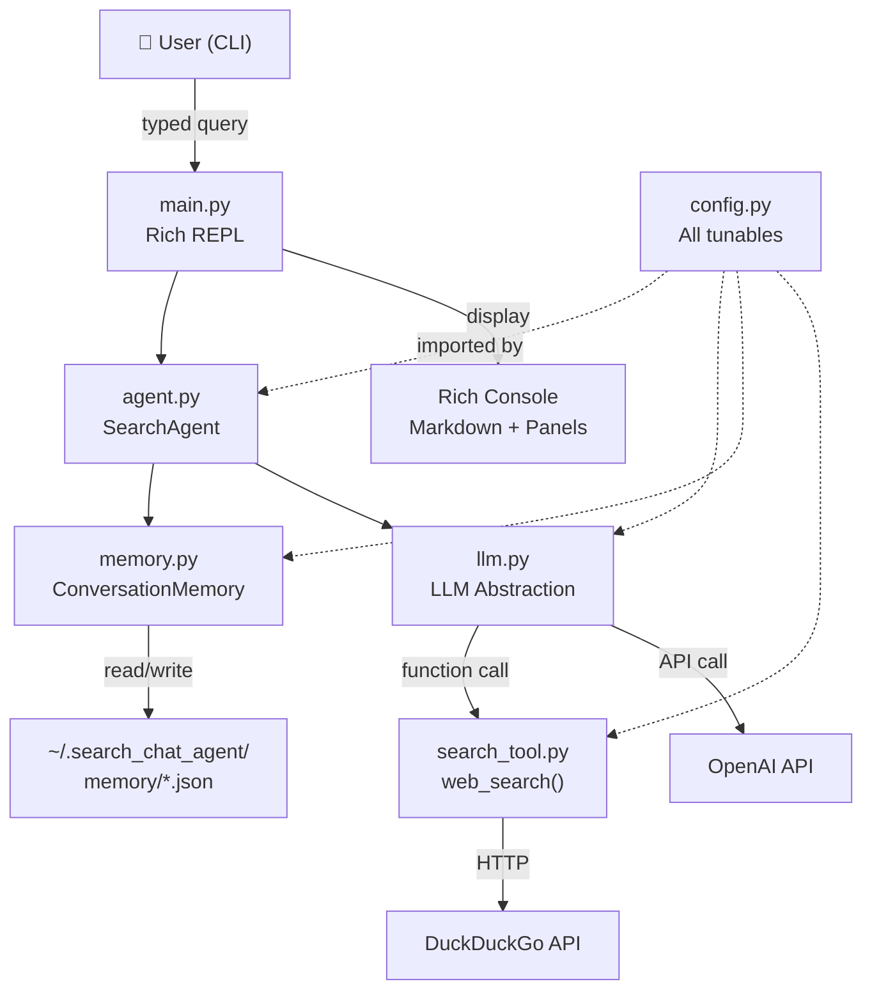
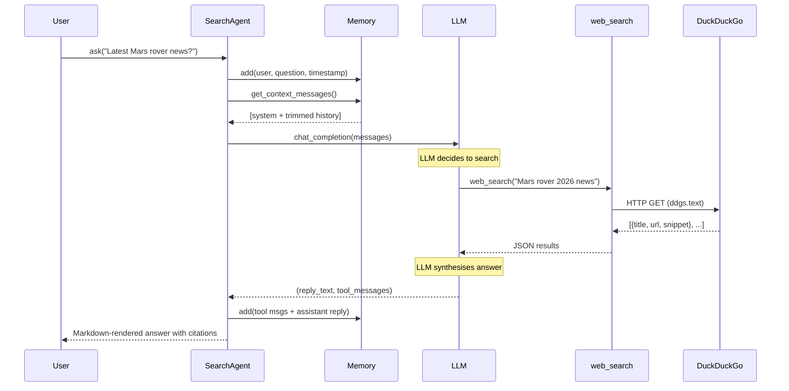
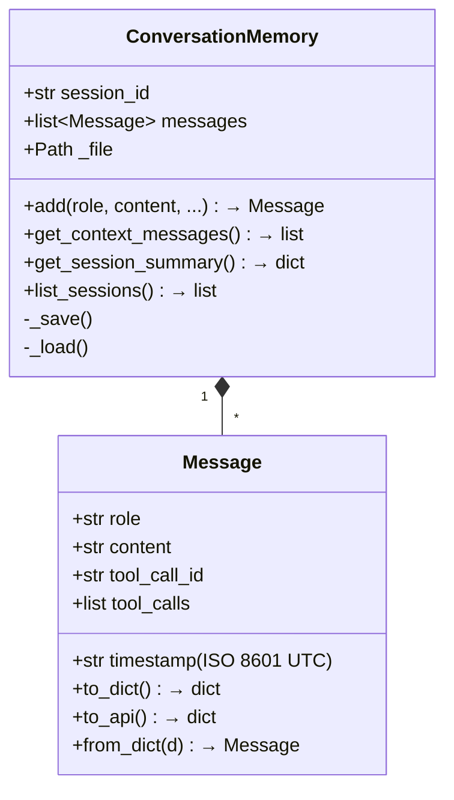

# 🔍 Search Chat Agent — Design Document

## 1. Overview

A **terminal-based conversational AI agent** equipped with a single tool — **web search** — designed around three pillars:

| Pillar | Goal | How |
|--------|------|-----|
| ⚡ **Speed** | Sub-3 s responses for non-search queries | Streaming-ready LLM, lightweight deps, async-capable search |
| 🎯 **Accuracy** | Grounded, cited answers | DuckDuckGo search + LLM function-calling; "search, don't guess" system prompt |
| 🧠 **Memory** | Full context of what was asked and when | Timestamped JSON persistence, token-aware context windowing |

---

## 2. Architecture



### Component Responsibilities

| Module | Lines | Responsibility |
|--------|-------|----------------|
| `config.py` | ~50 | Centralised configuration via env vars |
| `search_tool.py` | ~80 | DuckDuckGo search + OpenAI tool schema |
| `memory.py` | ~170 | Message model, session persistence, token-aware windowing |
| `llm.py` | ~100 | OpenAI chat completion with multi-round tool-call loop |
| `agent.py` | ~60 | Orchestrator: memory → context → LLM → store result |
| `main.py` | ~130 | Rich terminal REPL with `/commands` |

---

## 3. Data Flow — A Single Query



---

## 4. Key Design Decisions

### 4.1 One Tool Only — Web Search

> [!IMPORTANT]
> The agent is deliberately limited to a single tool. This forces the LLM to maximise the value of each search call and keeps the system simple, fast, and auditable.

- **Tool**: `web_search(query) → [{title, url, snippet}]`
- **Provider**: DuckDuckGo (free, no API key, privacy-respecting)
- **Result cap**: 5 results by default (configurable)
- **Timeout**: 8 seconds hard cap

### 4.2 Memory Architecture



**Key features:**

| Feature | Detail |
|---------|--------|
| **Timestamps** | Every message gets `datetime.now(UTC).isoformat()` |
| **Persistence** | JSON file per session in `~/.search_chat_agent/memory/` |
| **Token Budgeting** | Context window trimmed to `MAX_CONTEXT_TOKENS` (default 12K) |
| **Turn Cap** | At most `MAX_CONTEXT_TURNS` (default 50) recent turns |
| **Session Resume** | Pass `--session <id>` to pick up where you left off |
| **Session Listing** | `--list-sessions` or `/sessions` command |

### 4.3 LLM Integration

- **Primary**: OpenAI (`gpt-4o-mini` default — fast and cheap)
- **Tool-calling loop**: Up to 5 rounds of search before giving up
- **Temperature**: 0.3 (factual, low hallucination)
- **Max tokens**: 1024 per response

### 4.4 Speed Optimisations

| Technique | Impact |
|-----------|--------|
| `gpt-4o-mini` as default model | ~300 ms median latency |
| DuckDuckGo `backend="auto"` | Fastest available backend |
| 5-result search cap | Smaller payloads, faster parsing |
| Lazy `tiktoken` import | Falls back to `len(text)//4` if unavailable |
| Single client instantiation | Avoids repeated TLS handshakes |

---

## 5. File Structure

```
assign_sde/
├── config.py            # All configuration (env vars)
├── search_tool.py       # Web search tool + schema
├── memory.py            # Timestamped conversation memory
├── llm.py               # LLM abstraction + tool-call loop
├── agent.py             # Core SearchAgent orchestrator
├── main.py              # Rich CLI entrypoint
├── requirements.txt     # Python dependencies
├── .env.example         # Example environment variables
├── DESIGN.md            # This document
└── tests/
    ├── __init__.py
    └── test_agent.py    # Unit tests for memory, search, schema
```

---

## 6. Configuration Reference

All settings are read from environment variables with sensible defaults:

| Variable | Default | Description |
|----------|---------|-------------|
| `OPENAI_API_KEY` | *(required)* | Your OpenAI API key |
| `OPENAI_MODEL` | `gpt-4o-mini` | Model for completions |
| `SEARCH_MAX_RESULTS` | `5` | Max DuckDuckGo results per query |
| `SEARCH_TIMEOUT` | `8` | Search timeout in seconds |
| `SEARCH_REGION` | `wt-wt` | DuckDuckGo region (worldwide) |
| `MAX_CONTEXT_TURNS` | `50` | Max conversation turns in context |
| `MAX_CONTEXT_TOKENS` | `12000` | Token budget for context window |
| `MEMORY_DIR` | `~/.search_chat_agent/memory` | Session storage directory |

---

## 7. Usage

### Quick Start

```bash
# 1. Install dependencies
pip install -r requirements.txt

# 2. Set your API key
export OPENAI_API_KEY=sk-...        # Linux/Mac
set OPENAI_API_KEY=sk-...           # Windows

# 3. Run
python main.py
```

### CLI Flags

```bash
python main.py                      # New session
python main.py --session <id>       # Resume a session
python main.py --list-sessions      # Show saved sessions
```

### In-Chat Commands

| Command | Action |
|---------|--------|
| `/help` | Show help |
| `/sessions` | List saved sessions |
| `/info` | Current session metadata |
| `/clear` | Start a fresh session |
| `/exit` | Save & quit |

---

## 8. Testing

```bash
python -m pytest tests/ -v
```

Tests cover:
- **Message** serialisation roundtrips
- **ConversationMemory** persistence, token trimming, session listing
- **Tool schema** structure validation
- **web_search** mock success and failure paths
- **execute_tool_call** unknown-tool error handling

---

## 9. Future Enhancements

| Priority | Feature | Notes |
|----------|---------|-------|
| 🟢 High | Streaming responses | Use OpenAI streaming for real-time output |
| 🟢 High | `.env` file loading | Auto-load with `python-dotenv` |
| 🟡 Medium | Session search | Full-text search across past sessions |
| 🟡 Medium | Export to Markdown | `/export` command to save conversation |
| 🟠 Low | Web UI | FastAPI + WebSocket frontend |
| 🟠 Low | Multi-provider | Gemini, Anthropic, local models |
| 🟠 Low | RAG over sessions | Embed past sessions for cross-session recall |

---

## 10. Security Considerations

> [!CAUTION]
> - **API keys** are read from environment variables only — never hardcoded or logged.
> - **Session files** are stored locally in the user's home directory.
> - **DuckDuckGo** is used instead of Google to avoid API key requirements and respect user privacy.
> - **No data** is sent anywhere except OpenAI (for completions) and DuckDuckGo (for search).

